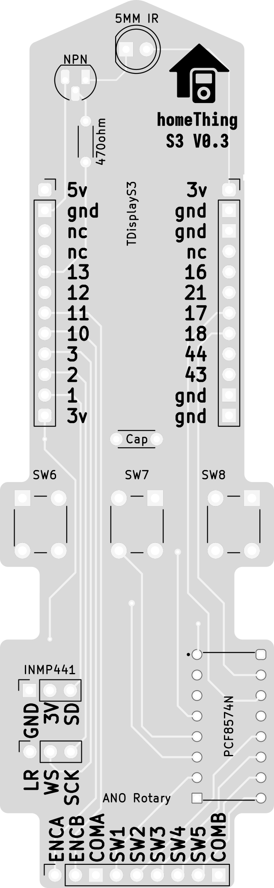
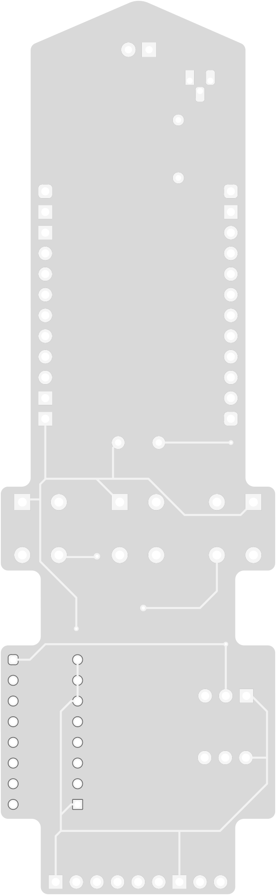

<h2>TDisplay S3 homeThing</h2>

This remote is no longer in active development. It can still be <a href="https://www.pcbway.com/project/shareproject/homeThing_S3_2b3ac3ac.html">ordered fully assembled from PCBWay</a>, and the files stay here for DIY builds. The successor is <a href="https://github.com/landonr/homething-c6">homeThing C6</a>, a universal remote with a scroll wheel, no screen, and better battery life.

<table>
    <tr>
        <th>TDisplay S3 homeThing Case</th>
        <th>homeThing S3 Circuit Front</th>
        <th>homeThing S3 Circuit Back</th>
    </tr>
    <tr>
        <td>
            
        </td>
        <td>
            
        </td>
        <td>
            
        </td>
    </tr>
</table>

<h2>Order</h2>
<a href="https://www.pcbway.com/project/shareproject/homeThing_S3_2b3ac3ac.html">Order Case and PCB from PCBWay</a>

Sold: 27 assembled, 32 PCBs, 10 cases

<h2>Case 3D Files</h2>
There's a separate front file for FDM printers. It has no extruded buttons, so it prints flat without supports.
<table>
    <tr>
        <th>Front (SLS)</th>
        <th>Front (FDM)</th>
        <th>Back</th>
    </tr>
    <tr>
        <td><a href="s3%20case%20front%20sls.stl">s3 case front sls.stl</a></td>
        <td><a href="s3%20case%20front%20fdm.stl">s3 case front fdm.stl</a></td>
        <td><a href="s3%20case%20back.stl">s3 case back.stl</a></td>
    </tr>
</table>

<h2>Circuit</h2>
<a href="gerber/">Gerber Files</a>

<h2>ESPHome Config</h2>
<a href="../../tdisplay-s3.yaml">tdisplay-s3.yaml</a>

<h2>Parts</h2>
<table>
    <tr>
        <th>Name</th>
        <th>Qty</th>
        <th>Description</th>
    </tr>
    <tr>
        <td><a href="https://www.pcbway.com/project/shareproject/homeThing_S3_2b3ac3ac.html">Custom PCB</a></td>
        <td>1</td>
        <td>Custom homeThing S3 PCB. Gerbers are in <a href="gerber/">gerber/</a>.</td>
    </tr>
    <tr>
        <td><a href="https://www.lilygo.cc/en-ca/products/t-display-s3?variant=42351558590645">TDisplay S3 (Soldered Pin)</a></td>
        <td>1</td>
        <td>ESP32-S3 board with screen. Plugs into the PCB.</td>
    </tr>
    <tr>
        <td><a href="https://www.adafruit.com/product/5001">Adafruit ANO Directional Navigation and Scroll Wheel Rotary Encoder</a></td>
        <td>1</td>
        <td>Directional buttons and scroll wheel</td>
    </tr>
    <tr>
        <td><a href="https://www.adafruit.com/product/5221">Adafruit ANO Rotary Navigation Encoder Breakout PCB</a></td>
        <td>1</td>
        <td>Breakout for the ANO encoder. Plugs into the PCB.</td>
    </tr>
    <tr>
        <td><a href="https://www.aliexpress.us/item/32962426410.html">INMP441</a></td>
        <td>1</td>
        <td>I2S microphone</td>
    </tr>
    <tr>
        <td><a href="https://leeselectronic.com/en/product/71446-ic-i-o-expander-for-i2c-8bit-pcf8574p.html">PCF8574N</a></td>
        <td>1</td>
        <td>I2C GPIO expander for the ANO and case buttons</td>
    </tr>
    <tr>
        <td><a href="https://www.adafruit.com/product/387">5mm 940nm IR LED</a></td>
        <td>1</td>
        <td>IR transmitter on GPIO13</td>
    </tr>
    <tr>
        <td><a href="https://leeselectronic.com/qc/product/7174-7174TRANSISTOR2N2222MPS2222ANPN5.html">2N2222 NPN transistor</a></td>
        <td>1</td>
        <td>IR LED driver</td>
    </tr>
    <tr>
        <td><a href="https://leeselectronic.com/en/product/91581-91581RESISTORS14W470OHM110PCS.html">470ohm resistor</a></td>
        <td>1</td>
        <td>IR LED current limit</td>
    </tr>
    <tr>
        <td><a href="https://leeselectronic.com/en/product/844-polyester-cap-50v-01uf-4pcs.html">0.1uF capacitor</a></td>
        <td>1</td>
        <td>Decoupling for the PCF8574</td>
    </tr>
    <tr>
        <td><a href="https://leeselectronic.com/en/product/31231-tack-switch-6x6x10mm.html">6x6mm tactile switch (10mm tall)</a></td>
        <td>3</td>
        <td>Through-hole tact switches for the case buttons</td>
    </tr>
    <tr>
        <td><a href="https://www.aliexpress.com/item/32835179410.html">3.7V 7x20x50mm 700mAh Lipo</a></td>
        <td>1</td>
        <td>Battery</td>
    </tr>
    <tr>
        <td><a href="https://leeselectronic.com/en/product/6049-6049BOLTM25100PCS.html">M2.5x8mm screws</a></td>
        <td>6</td>
        <td>Case screws</td>
    </tr>
    <tr>
        <td>Female pin socket 1x12, 2.54mm</td>
        <td>2</td>
        <td>T-Display S3 plugs into these</td>
    </tr>
    <tr>
        <td>Female pin socket 1x09, 2.54mm</td>
        <td>1</td>
        <td>ANO breakout plugs into this</td>
    </tr>
    <tr>
        <td>Female pin socket 1x03, 2.54mm</td>
        <td>2</td>
        <td>INMP441 plugs into these</td>
    </tr>
    <tr>
        <td>Male pin header 1x04, 2.54mm (optional)</td>
        <td>1</td>
        <td>Optional expansion header: 5V, GPIO12, GPIO16, GND</td>
    </tr>
</table>
